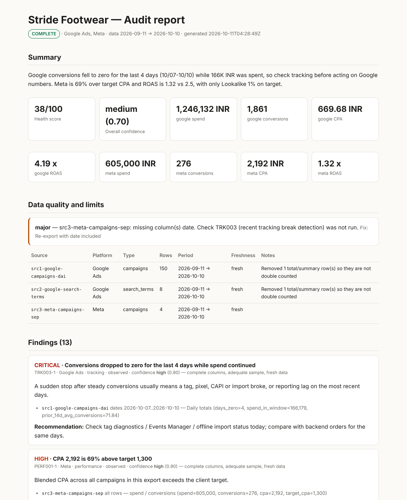

# SpendSentry: open-source AI PPC agent for Google Ads, Meta Ads and 10 more ad platforms

**SpendSentry is an open-source AI PPC agent for Claude Code that audits ad accounts, checks pacing, plans budgets and writes client reports across 12 ad platforms. It can't change an account unless you approve the exact change.**

Built for paid media experts: PPC managers, paid social and performance marketing teams, and agencies. Created by [Ravi Nirban](https://github.com/nirbanravi). Website and guides: **https://nirbanravi.github.io/ppc-agent/**


*Report generated from the synthetic sample exports in `skills/ads/examples/exports/`, not a real client.*

## Why this exists
AI agents can now write to ad accounts through MCP servers, and several official servers (Meta's, Amazon's) support create/update/delete. A confident wrong change can burn a month's budget in an afternoon. SpendSentry is built the other way round:

| | Typical AI ads tools | SpendSentry |
|---|---|---|
| Account writes | The model decides | Blocked by a hook unless the **exact** tool call matches a gated changeset you approved |
| Numbers in the report | Generated | Computed from your exports; each finding cites file, rows and values |
| Missing / stale data | Rarely mentioned | Listed in every report and downgrades run status to `partial` |
| Confidence | Implied | Scored 0–1 with reasons (sample size, freshness, missing columns, tracking breaks) |
| History | Chat scrollback | Versioned, hashed JSON per run → Markdown + HTML |
| Platform rules | Model memory | Registry with verification dates; stale entries trigger a fresh lookup |

## Install
```text
/plugin marketplace add nirbanravi/ppc-agent
/plugin install spendsentry@spendsentry
```
Then in any project: `/ads audit google ./exports/*.csv` (or `/spendsentry:ads …`). Requires Python 3.9+; no packages needed.

## Commands
| Command | What you get | Touches the account? |
|---|---|---|
| `/ads audit` | Scored findings with evidence, impact ranges, gaps | No |
| `/ads monitor` | Pacing vs budget, tracking breaks, anomalies | No |
| `/ads plan` | Budget allocation and structure with rationale | No |
| `/ads experiment` | Test backlog with MDE, duration, decision rules | No |
| `/ads report` | Client-ready Markdown/HTML from finalized runs | No |
| `/ads optimize` | Ranked changes packaged as a gated changeset | Only after you approve |
| `/ads create` | New campaigns as a changeset, created paused | Only after you approve |
| `/ads validate` | Schema, integrity hash, gate re-check, docs freshness | No |

## How approval works
1. Claude proposes exact actions (before → after, rollback, evidence finding IDs).
2. A gate checks them: fresh data (≤72h), allow-listed accounts, budget change ≤ ±30%, bid change ≤ ±25%, no deletes, new entities paused, evidence exists, rollback defined.
3. You see the list and a code like `ADS-C15127`. You approve by sending `APPROVE ADS-C15127`.
4. A hook records the approval, bound to the changeset hash and each call's exact input. The guard allows each approved call once. Changed inputs, replays, edited changesets and expired approvals are blocked, and so are attempts to forge an approval file or send raw HTTP writes to ad APIs.

Details and known limits: [safety model](skills/ads/references/safety-model.md).

## What's tested
- `tests/run_tests.sh`: 15 end-to-end checks (ingest → audit → finalize → immutability → gate → approval → guard → pacing), run in CI on Linux and macOS with Python 3.9, 3.11 and 3.13.
- `evals/`: behaviour evals run with `claude plugin eval` against a no-plugin baseline (e.g. "does not claim account changes without approval").
- Manifests are checked with `claude plugin validate --strict`.

## Honest limits
- The automated checks cover tracking breaks, zero-conversion spend, CPA/ROAS vs target, budget and rank limits, CTR outliers, frequency, concentration, search-term waste, pacing and anomalies. Everything else is Claude's judgment, held to the same evidence rule, and it can be wrong.
- Column mapping has been tested on sample exports in each platform's common format, not on every locale and report variant. If an export maps badly, please open an issue with headers only.
- Bash-level detection is pattern-based. The strong guarantees cover MCP tool calls and the approval itself. Keep ad API credentials out of your shell.
- Platform facts were verified on 2026-10-11. Pinterest and Snapchat entries are unverified.

## FAQ
**What is SpendSentry?** An open-source AI PPC agent (a Claude Code plugin) for paid media audits, pacing, budget planning, experiments and client reporting across Google Ads, YouTube, Meta Ads, LinkedIn Ads, TikTok Ads, Microsoft Advertising, Amazon Ads, Reddit Ads, Pinterest Ads, Snapchat Ads, Apple Ads and X Ads.

**Can I use it for a Google Ads audit?** Yes. Export your campaign and search terms reports, or connect read-only access, then run `/ads audit google`. You get scored findings such as tracking breaks, wasted search terms, budget- and rank-limited campaigns, and CPA/ROAS against target. Each finding cites the rows behind it.

**Can it make changes in my ad account?** Only after you approve. It proposes exact changes, a gate checks them against limits, and you approve by typing a code. Every other write is blocked by a hook.

**Is it free?** Yes, MIT-licensed. It runs locally in Claude Code; the engine sends your exports nowhere.

**How is it different from claude-ads, Adspirer or Optmyzr?** claude-ads is a broader open-source audit skill. Adspirer and Optmyzr are hosted SaaS. SpendSentry focuses on two things: enforced approval for every account change, and versioned, evidence-linked run records you can hand to a client.

## Contributing
Platform rule updates, export header aliases and new checks are the most useful contributions. See [CONTRIBUTING.md](CONTRIBUTING.md).

## License
MIT. See [LICENSE](LICENSE).
